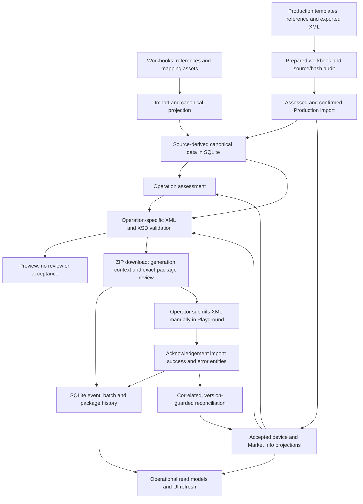

# Architecture Definition Document Draft

## Document Status And Purpose

Reviewed and updated 11 October 2026 against current source and the [session handoff](session-handoff.md). Production preparation, importing and exported-baseline evidence are implemented. The first local Production startup and reviewed import were completed on 10 October. Dated counts below are checkpoints, not live inventory.

This document describes the application's architecture, responsibilities, state transitions and design boundaries. Implemented behavior is distinguished from future deployment, audit and transport proposals. The handoff contains session continuity and verification details; the [Playground test report](eudamed-playground-test-report.md) contains execution evidence. Historical Playground findings do not establish current production registration state.

This is a working architecture definition. Deployment topology, formal non-functional requirements, operational ownership and production security/transport controls still require stakeholder input. This refresh changes documentation only.

## Business Context And Application Creator

The application was created in response to demand for an EUDAMED registration solution for Blatchford manufactured products.

Application creator: **Frank C Bogle**, Head of Enterprise Solutions, Blatchford Mobility UK.

Excel workbooks supply device data, but do not by themselves establish accepted regulatory state, stable submission lineage or reliable next-operation eligibility. The application provides controlled preparation, local validation and recorded registration evidence for manual EUDAMED workflows. Dev supports Playground testing; Production uses its own sources, schema, actors and database. Downloading XML does not submit it.

The immediate business objectives are to:

- Separate Basic UDI-DI parent registration, Device UDI-DI child registration, device PATCH and Market Info updates.
- Generate and locally validate operation-specific XML with traceable device identity and accepted-state lineage.
- Treat preview, operator review and EUDAMED acceptance as distinct events.
- Make bulk selection and operational counts reflect recorded state for each device.
- Retain the existing operator UI while consolidating shared backend rules and frontend orchestration.

## Scope And Delivery Boundary

Implemented capabilities include workbook import/profiling, canonical interpretation, completeness and XML-readiness checks, local XSD validation, operation assessment, single and bulk XML generation, ZIP review receipts, acknowledgement import, accepted-state projections and SQLite read models.

The six visible XML workspaces are:

| Workspace | Regulatory operation and boundary |
| --- | --- |
| POST | `DEVICE.POST` for a new Basic UDI-DI parent seed; child-only `UDI_DI.POST` when the parent already exists. |
| Patch XML | Exact-device, scenario-derived `UDI_DI.PATCH`. The only single-device PATCH workspace. |
| Market Info | Standalone `MARKET_INFO.PUT` for a registered device. |
| Bulk UDI-DI POST | Child-only registrations under accepted Basic UDI-DIs; the visible Bulk POST control selects this flow. |
| Bulk PATCH | One scenario applied to registered children, with an independent accepted baseline per device. |
| Bulk Market Info | One explicit target country list applied to registered children, with an independent starting state and next version per device. |

Bulk Basic UDI POST remains a separate supported backend/API operation. Its inaccessible frontend branch was removed, as was the old generic Single XML frontend branch. Backend single-record endpoints and directly tested generic batch compatibility helpers remain; those generic batch helper functions are not decorated HTTP routes. The former Post + Patch baseline-pair workspace is obsolete.

Out of scope for the current implementation are direct EUDAMED upload, AS4/eDelivery/M2M transport, automatic response polling, live registration lookup/automatic baseline refresh and the final production submission/audit model. Existing package/event history is implemented evidence, but should not be described as a complete production audit solution.

## Stakeholders And Responsibilities

| Stakeholder | Responsibility |
| --- | --- |
| Business sponsor | Business priorities, workflow direction and delivery sequencing. |
| Regulatory Affairs lead | Regulatory interpretation, valid message expectations, acceptance evidence and scenario suitability. |
| Regulatory operations user | Assess availability, inspect previews, download reviewed ZIPs, perform manual Playground tests and import all returned acknowledgements. |
| Product/source data owner | Workbook meaning, source corrections and interpretation gaps. |
| Solution architect | Separation of concerns, identity/state boundaries and controlled transition to production. |
| Engineering | Implementation, persistence, validation, regression coverage and operational feedback. |

These are responsibility assignments, not a claim that application role-based access controls are implemented. The project owner remains involved in material architecture and workflow decisions under [AGENTS.md](../AGENTS.md). ZIP download as review confirmation is an approved, implemented decision.

## Architecture Principles

1. Build a schema-aware regulatory preparation platform rather than a one-off Excel-to-XML converter.
2. Keep source evidence, canonical interpretation, validation, accepted state, XML assembly and future transport separate.
3. Treat workbook/canonical data as proposed business data, not evidence of EUDAMED acceptance.
4. Centralize operation readiness in backend assessment services and preserve exact device/parent identity across the UI workflow.
5. Keep parent POST, child POST, PATCH and Market Info as distinct operations, including in bulk processing.
6. Derive PATCH from accepted device state and retain the separately accepted Market Info countries.
7. Preview generation is a check and ZIP download confirms review of the packaged contents. Validated Production exports establish initial accepted baselines with explicit provenance; subsequent successful acknowledgements advance accepted state.
8. Preserve immutable historical evidence while preventing old acknowledgements from rolling back newer accepted projections.
9. Use direct Device Model selection over existing family/variant identity, while preserving operation-specific controls and exact-device context.
10. Evolve the existing SQLite model incrementally, without silently reinterpreting historical data.

## Application And Logical Architecture

The application consists of a Python 3.11/FastAPI backend, a React/TypeScript/Vite frontend, source/reference/schema assets and SQLite persistence. The active operational services use the existing SQLite connection and schema-initialization mechanisms; this change does not replace them with a new database or persistence framework.

The shared operator areas are Submission Data, Canonical Validation, Registration State, the XML workspaces, Submission/Testing Summary and Documentation. Labels follow the active backend environment. Registration State contains Registration State and Parents & Children tabs in both profiles.

### Component Responsibilities

| Boundary | Current implementation and responsibility |
| --- | --- |
| Source import | Dev uses `WorkbookImportService` for raw templates. Prod uses `ProductionWorkbookImporter` for the prepared workbook/audit pair. Both populate the shared SQLite schema with source lineage and identity checks. |
| Canonical interpretation/projection | Canonical services normalize source concepts and persist XML-relevant fields with workbook/sheet/row lineage. |
| Canonical validation | SQLite projections expose canonical completeness separately from XML readiness. Prod presents nonblocking completeness notes and XML-ready/blocked status; Dev retains its completeness-oriented labels. Message-specific assessment and XSD validation remain separate checks. |
| Operation assessment | `OperationAssessmentService` evaluates single POST, single PATCH, single Market Info, bulk POST, bulk PATCH and bulk Market Info. It returns status, blocking reasons, eligible counts, next action, identity scope and evidence. |
| Accepted-state resolution | [accepted_state.py](../backend/app/services/accepted_state.py) supplies shared accepted POST, device/PATCH and Market Info snapshot resolution to generation and read models. |
| XML generation | Selection, projection, rendering, validation and packaging services create the operation-specific payload and envelope. `XmlGenerationService` orchestrates the workflow. |
| ZIP review | The shared download-package helper records review of the exact successfully prepared archive through `TestingStateStore`. |
| Acknowledgement reconciliation | `TestingSuccessXmlService` records response entities, correlates generated context and updates eligible accepted-state projections. |
| Operational read models | `TestingReadModelService`, import read models and `RegistrationSummaryService` supply device/history/monitoring views, uncapped reconciled counts and paged parent-child details. |

Source normalization occurs before generation. For example, `ON_THE_EU` and `ON_THE_EU_MARKET` map to `ON_THE_MARKET`. Import refresh is required for mapping corrections to reach the persisted canonical projection. [identity.py](../backend/app/services/identity.py) consolidates family/identity normalization across selection, generation, testing state and read models; it does not yet eliminate text-based identity matching.

## Data Architecture

### Source And Proposed State

File-backed inputs include Excel workbooks, Basic UDI reference data, mapping/configuration assets and the local EUDAMED schema pack. SQLite stores the imported source evidence and canonical projection used by the testing workflows.

Canonical records retain source lineage, catalogue/Device UDI-DI/Basic UDI-DI identity, regulatory field paths and readiness results. They are source-derived data used for proposed XML. Dev source imports do not establish acceptance. Production imports separately persist trusted exported baselines; repeat-import safeguards protect newer locally accepted state and report changed existing devices instead of silently overwriting them.

### Implemented SQLite Model

Database and backups are profile-selected through `EUDAMED_TESTING_STATE_DB_PATH` and backup settings. The legacy development defaults are `data/testing/testing-state.sqlite3` and `data/testing/backups`; the configured Production instance uses `data/prod/application.sqlite3` and `data/prod/backups`. Dev and Prod remain isolated while sharing the table design. See [environment profiles](environment-profiles.md).

| State area | Tables and role |
| --- | --- |
| Import evidence | `import_batch`, `source_workbook`, `source_row` preserve imported source context. |
| Stable identity and issues | `device_subject`, `device_identity_issue` link source rows to devices and retain conflicts requiring attention. |
| Canonical projection | `canonical_device_record`, `canonical_field_value`, `canonical_projection_snapshot` persist interpreted/validated source data. |
| Accepted projections | `testing_subjects` holds registration flags, separate accepted POST/PATCH/Market Info versions and snapshots, and observed Market Info version evidence. Prod also records imported export baselines with separate provenance. |
| Per-device history | `testing_events` stores generated contexts and acknowledgement events with envelope, scenario, version and before/after metadata. |
| Batch lineage | `testing_batches`, `testing_batch_devices` group envelopes and per-device outcomes. Batch read APIs and a backfill service are implemented. |
| Package/review evidence | `generated_packages` stores package metadata, archive fingerprints and exact-member review receipts. |
| Legacy POST history | `reviewed_post_baselines` retains historical POST-download indicators; it is not a gate or proof of review of a current draft. |

`device_subject` is the intended stable application identity. `testing_subjects` and legacy reviewed POST rows already have `device_subject_id` links. Some selection and lineage resolution still use family/variant/catalogue strings, aliases and UDI matching. Compatibility fields including `post_success`, `latest_successful_version` and `latest_successful_state_json` remain in use.

The model is an operational projection plus recorded history. It is not a claim of complete event sourcing, universal replay, complete historical snapshots or production audit certification.

## Review And State-Transition Contract

| Action | Persisted meaning | Effect on accepted state |
| --- | --- | --- |
| Import/re-import Dev source data | Source/canonical projection and import evidence. | Does not establish regulatory acceptance. |
| Confirm assessed Production import | Eligible source/canonical records plus explicitly identified export baselines. | Establishes imported acceptance evidence for exported devices/parents; does not create successful upload events. |
| Generate ordinary preview | Candidate XML and validation feedback; no ZIP review receipt or ordinary submission-context write. | None. |
| Log generation context | Append-only generated payload context. This alone does not prove review. | None. |
| Download ZIP | Generation context for supported submission flows, package metadata and review of the exact prepared ZIP. | None. |
| Edit the draft afterward | A different proposed device/scenario/version/country state. The earlier review remains history only. | None. |
| Import successful acknowledgement | Recorded success; accepted-state update only where correlation/version rules permit. | May advance the relevant accepted projection. |
| Import error acknowledgement | Error evidence and, when reported, a Market Info observed version floor. | Does not accept the rejected payload. |

### ZIP Review Receipt

The owner confirmed that downloading a ZIP is the explicit review action in every XML ZIP workflow. No additional review button is required, and preview generation must not require a previous POST ZIP download.

All eight ZIP download paths call `XmlGenerationService._build_and_record_package`: single POST, scenario PATCH, single Market Info, bulk Basic UDI POST, bulk UDI-DI POST, bulk PATCH, bulk Market Info and the generic batch compatibility helper. Raw XML-only downloads do not create ZIP-review receipts.

After successful archive construction, `record_generated_package(..., confirms_review=True)` stores:

- `package_sha256`: the exact archive fingerprint.
- `reviewed_at` and `review_basis = zip_download`: the review action and time.
- `reviewed_members_json`: file names and SHA-256 hashes of every archive member, including the manifest.
- Existing flow, scope, filename, size and manifest metadata.

This records the explicit download request and successfully prepared contents; it does not verify an operating-system file save. Failed archive preparation leaves no receipt. The default package-recorder call uses `confirms_review=False`, so package creation metadata alone is not treated as review.

A review attaches to that artifact, not indefinitely to a device. Changing a scenario, version, country list or other packaged contents requires another download to record review of the changed artifact. Previous receipts remain historical evidence. The package table stores hashes and metadata, not duplicate XML bodies or ZIP blobs; operators must retain downloaded artifacts.

The three nullable review columns are added through existing schema initialization. Historical package rows are not backfilled as reviewed. Legacy POST history is maintained only after successful POST ZIP preparation. The optional reviewed-POST PATCH gate has been removed; the compatibility evidence field `reviewed_post_baseline_present` is historical information, not current-draft review or a readiness prerequisite.

## Accepted-State And Operation Design

### POST And Child Registration

Single POST is assessment-first: the Device Model selection (an existing family/variant pair) resolves the next eligible candidate, avoiding already registered Device UDI-DIs. An unregistered Basic UDI-DI requires a parent seed using `DEVICE.POST`; subsequent child-only registration uses `UDI_DI.POST` and references that parent through `basicUDIIdentifier`.

Bulk Basic UDI POST keeps parent registration separate at the backend/API boundary. Bulk UDI-DI POST includes eligible unregistered children under accepted parents. A source row or reviewed ZIP does not establish parent/child registration success.

New POST generation contexts capture the complete `DeviceXmlRecord` projection, including nested warnings, storage conditions and market countries. Only a matching successful acknowledgement promotes that context into accepted POST state.

### PATCH Lineage

Single PATCH retains the exact selected device across assessment, baseline loading, scenario generation, download and acknowledgement refresh. Family/variant context alone must not silently switch to another sibling device.

- Version 2 derives from accepted POST state. Equivalent First Patch changes the version without a business-field delta; a supported edit can instead be the first targeted update.
- Later scenario PATCHes apply the accepted PATCH fields over the accepted POST projection. Non-target values retain accepted state rather than adopting subsequent workbook edits.
- PATCH payloads repeat the latest separately accepted Market Info country list. Later accepted Market Info takes precedence over original POST and workbook countries.
- Baseline loading for PATCH/Market Info requests the accepted projection with `accepted_baseline=True`.
- Bulk PATCH uses the same per-device derivation logic. A cohort does not share one assumed accepted version. Download resolves its generated preview's included records rather than silently restoring excluded devices.

Older accepted entries can have partial snapshots or no snapshot. Compatibility fallback remains for unavailable historical fields. Complete protection from workbook drift cannot be claimed for data never captured in accepted history; that recovery problem is still open.

Current operation eligibility relies on recorded registration evidence and available accepted lineage, including trusted Production export baselines. A loaded baseline is a readiness condition, not a review event. Accepted-registration, version, scenario and unresolved Market Info rejection guards remain after removal of the old review prerequisite.

Scenario implementation and regulatory suitability are separate. Sterile and Latex are disabled in the UI following recorded Playground rejection, even though lower-level XML builders exist. Status Code remains an enabled testing scenario with failure evidence. Candidate scenario entries must not be represented as universally accepted EUDAMED updates. Current scenario availability is detailed in the handoff and source configuration.

### Market Info And Bulk Market Info

`MARKET_INFO.PUT` has an independent accepted country snapshot and version. Success does not advance the core device/PATCH version.

The next proposed Market Info version is `max(accepted Market Info version, observed EUDAMED version floor) + 1`. A reported version-scheme error can raise the observed floor without accepting the proposed countries. Single Market Info validates the supplied version against the observed floor; bulk generation derives each device's next version separately.

Both assessment and generation allow mixed accepted starting country lists for one explicit bulk target list. The earlier mixed-baseline decision is resolved. Accepted state differing from source-workbook countries is not itself a PATCH exclusion.

An unresolved `marketInfoLink` PATCH rejection is a device-specific pending condition. A later successful Market Info acknowledgement clears that condition before another PATCH is attempted. After success, the UI uses SQLite accepted countries rather than the user's most recent unsent draft.

These evidence-led rules are shared by Dev and Production. Imported device and Market Info versions retain their separate domains; a PATCH counter cannot substitute for missing Market Info state. Local readiness is not proof of live EUDAMED acceptance.

## Acknowledgement Correlation And Audit History

The upload endpoint supports `DEVICE.POST`, `UDI_DI.POST`, `UDI_DI.PATCH` and `MARKET_INFO.PUT`, including multi-entity success/error responses. Every returned acknowledgement should be imported before a dependent next operation.

Generation context is tied to the actual downloaded XML envelopes. Bulk Market Info records every included device against the downloaded chunk's shared correlation/message IDs. Generated events remain append-only; ordinary repeated previews do not create that submission history.

Correlation follows this order:

1. Match subject, message type, correlation ID and message ID.
2. If appropriate, match the same correlation ID when the response uses a different message ID.
3. For acknowledgements without identifiers, permit the legacy fallback only when exactly one generated candidate exists.

An identified acknowledgement with no matching correlation cannot accept an arbitrary latest draft. An acknowledgement may establish a tracked version without enough context to recover its payload; another draft must not be invented as its accepted snapshot.

Duplicate imports are idempotent. Older successes remain in history without rolling newer accepted version/state projections back. Duplicate processing can repair missing projections where trustworthy generated context exists. Error entities retain evidence independently and do not advance accepted payload state.

`testing_events` includes `event_kind`, scope, batch/envelope IDs, scenario, base/derived versions, accepted-state source, before/after state and delta metadata. Legacy status values such as `GENERATED` and `SUCCESS` remain. Batch envelopes, per-device events and ZIPs are separate concepts: one ZIP may contain multiple envelopes/devices, so package receipts must not be treated as individual device acceptances.

## Frontend And Read-Model Architecture

Retain the existing assessment cards, scenario editors, preview cards, metadata/status strips, XML structure navigation and acknowledgement controls. The consolidation changes the ownership of decisions and removes disconnected branches, rather than adding new operator steps.

- `/api/xml/operation-readiness` supplies XML-workspace readiness using the existing operation assessments. Registration counts call the same assessment service with scoped canonical payloads; entering Registration State no longer loads the separate full readiness endpoint.
- [xmlAssessmentRequest.ts](../frontend/src/xmlAssessmentRequest.ts) is the shared dispatcher for initial assessment and acknowledgement refresh.
- [useSuccessXmlUpload.ts](../frontend/src/useSuccessXmlUpload.ts) checks operation, family, variant, catalogue and parent scope before applying asynchronous upload results to the visible workspace.
- [useBulkPostedCohorts.ts](../frontend/src/useBulkPostedCohorts.ts) loads posted parents/devices from backend queries for bulk PATCH/Market Info. Workbook row-count estimates and sample-catalogue fallbacks no longer substitute for actual cohorts.
- Frontend readiness says **accepted baseline loaded**; POST review is labelled as history. Download feedback confirms review of the ZIP without marking the generated update as accepted.
- Shared normalization and accepted-state resolution reduce divergent frontend/backend interpretations. Remaining text/alias matching is transitional and must stay consistent until relational identity work replaces it.

Submission Data reads SQLite import/snapshot/monitoring information; it is not a live direct-Excel inventory. Registration State and Testing Summary consume operational readiness and history. `App.tsx` remains substantial, but the removed Single XML/Bulk Basic UDI UI branches, unused clients/types/state and generic preview component are no longer current risks to remove again.

### Model Selection And Search Contract

The shared [DeviceModelSelector](../frontend/src/components/DeviceModelSelector.tsx) replaces hierarchical family/variant selection across the six visible XML operations. One row selects the complete pair; the row shows model, family, available Basic UDI-DIs, device count and XML-ready/blocked counts. A scrollable list, optional family filter and name/identifier search accommodate a larger production catalogue. Searching choices does not change generation scope until a row is selected.

The current selection flow is:

1. Find a model by name, family or Basic UDI-DI, with an optional family filter.
2. Select one Device Model row to set family and variant together.
3. Let backend assessment determine eligibility for that model and operation.
4. Choose any required device, parent or bulk scope and generate the eligible XML. Single POST resolves the next eligible candidate; PATCH and Market Info preserve the selected device's accepted lineage.

The UI model is a presentation of the existing family/variant pair, not a new canonical entity. Database fields, API scope, parent/device identifiers and accepted-state lineage remain unchanged. A pair may expose multiple Basic UDI-DIs; model selection does not replace operation-specific parent or exact-device selection.

[DeviceModelFilter](../frontend/src/components/DeviceModelFilter.tsx) provides combined selection and an All models option in Device Subjects, Canonical Model, Registration State, Testing Summary and EUDAMED Activity. Canonical Model, Registration State and Testing Summary connect a controlled search to their displayed data. Typing clears older model scope, model selection clears the query, and unmatched searches show empty results. The other two workspaces use search to narrow choices; Activity retains explicit filter application.

Canonical search scopes source-sheet mappings, record selection and counts; Canonical Mapping displays the selected matching record's fields. Registration search scopes rows and metrics alongside status/actionable filters. Testing Summary scopes rows, counts, recent subjects and event history, resetting event pagination and expanded detail when search changes. Matching is case-insensitive with trimmed partial identifiers. Search-feedback space is reserved in the Registration Footprint and Testing Summary filter grids.

Detailed Testing Summary lists still load at most 10,000 subjects/events per request and disclose the history limit. Registration State and Testing Summary / Submission Summary aggregate counts now use the uncapped `POST /api/xml/registration-summary` SQLite calculation, with identity reconciliation, filtering and snapshot consistency checks. Repeated operation successes do not increase distinct registered-device totals. Prod template-only devices are awaiting registration; devices without either matched accepted evidence or trusted template classification remain unknown. See [registration counts](registration-counts.md) for scope and exceptions; the history list limit does not cap those aggregates.

### Registration and Canonical Read Models

Registration State has two shared internal tabs: the original counts/operation
view and **Parents & Children**. The latter groups filtered model rows by issuer
plus Basic UDI-DI, preserving distinct issuers. Expanding a parent calls
`POST /api/xml/registration-children`; the UI requests 20 children per page.
Child details show model, catalogue, issuer-qualified UDI-DI, recorded registration
status and independent XML eligibility. Filters scope the displayed children;
unknown status is never inferred as awaiting registration from POST readiness.

Both registration endpoints reuse the same identity reconciliation and operation
assessment. The summary uses the latest canonical SQLite snapshot, assesses the
selected model/search scope, and retains whole-import identity conflict checks.
Request-local selection and accepted-state reads are reused; no long-lived count
cache is introduced. Snapshot markers reject concurrent import/acceptance changes.
Refreshing counts clears expanded details; cancelled requests cannot overwrite a
new selection. See [registration counts](registration-counts.md).

Canonical Validation reads the same imported projection. In Production, missing
broader canonical fields are completeness notes unless needed for XML. An explicit
exported UDI-DI status can populate the duplicate market-status completeness field
when reading an older snapshot; unknown flags are not guessed and the database is
not rewritten for that correction. Registration evidence is independent of both
completeness and XML readiness. See the [Canonical Validation guide](../frontend/src/content/docs/canonical-validation.md).

The Documentation viewer supports Markdown links, heading navigation and tables.
Relative document paths resolve against repository source paths; links open the
corresponding sidebar section. Literal code and unsafe/raw HTML remain text.

### Environment Identity And Schema Profiles

One codebase supports Dev (Playground) and Prod through explicit backend startup selection and isolated `.env.dev` / `.env.prod` configuration. Process settings take precedence over the selected file; dotenv loading does not mutate process state. Prod never silently loads the legacy Dev `.env`. See [environment profiles](environment-profiles.md) for startup commands, configuration precedence and storage/actor checks.

| Profile | Schema bundle | Message version |
| --- | --- | --- |
| Dev | `data/schema_profiles/dev-3.0.32-derived` | 3.0.32; derived from the historical 3.0.30 bundle, not an official 3.0.32 distribution. |
| Prod | `data/schema_profiles/prod-3.0.30` | Official downloaded 3.0.30 package. |

Startup validates the selected message constraint and compiles the schema before database-backed services start. Prod requires explicit actor/source/storage settings, isolated writable paths and a separate SQLite database. The SQLite schema design remains shared. Startup initializes the operational schema; baseline evidence is loaded only by the reviewed Production import. Acceptance is never migrated from Dev, and neither profile provides EUDAMED transport. Read-only `--check-config` supports configuration review without creating a database.

The shared [EnvironmentBanner](../frontend/src/components/EnvironmentBanner.tsx) obtains the active profile from `GET /api/environment`. It shows PLAY / EUDAMED Playground for Dev and PRODUCTION / EUDAMED Production for Prod, with the backend-configured message schema version, package provenance, manufacturer SRN and authorised representative SRN alongside. Actor details show configured values, explicit suppression or unconfirmed/unconfigured state rather than invented identifiers. Known bundled schema paths are labelled Derived package or Official package; other paths are labelled Custom package. Labels are not a runtime integrity certification or a claim of EUDAMED recommendation. Loading/errors remain unconfirmed, with retry after failure. It appears above every workspace and scrolls normally with the page, as requested by the owner. This is a backend-profile indicator, not an environment selector or validation of database contents. The frontend currently targets `http://localhost:8000/api`; deployment-specific routing still needs configuration.

## Configuration, Evidence And Verification

Recent October 10–11 checkpoints are recorded in the [handoff](session-handoff.md):
the registration performance work passed 112 focused backend tests; parent-child
read-model coverage passed 28 registration-summary tests; and the documentation
viewer checkpoint passed all 96 frontend tests and the TypeScript/Vite build.
These are separate dated runs, not a claim that the full backend suite was rerun
for this documentation-only architecture update.

The repository uses Python 3.11, profile-selected message schemas (Dev `3.0.32`, Prod `3.0.30`) and a configurable batch limit of 300. Bulk UDI-DI POST also offers Next 100 records for operator selection. XML testing services use the imported canonical projection; compatibility/non-import-required service paths can still use workbook fallback.

Testing actor configuration includes `EUDAMED_MANUFACTURER_SRN_OVERRIDE`, `EUDAMED_AUTHORISED_REPRESENTATIVE_SRN_OVERRIDE` and `EUDAMED_SUPPRESS_AUTHORISED_REPRESENTATIVE`. These controls must match the actual testing environment. The message-schema default reflects the recorded August 9 Playground requirement and bundled local schema; it is not a newly verified public EUDAMED release claim.

Earlier Navigator/Javelin/Linx testing established the Market Info/PATCH reconciliation safeguards: the recorded sequence included 29 Market Info successes and one version error, a successful corrective single Market Info version 3, and a subsequent 31-device bulk PATCH success. Detailed subject IDs and action labels belong in the test report/handoff; those historical results do not prove current inventory or live environment behavior.

Historical implementation verification recorded on September 9:

- Full backend suite: 147 tests passed.
- Focused ZIP-review run: 15 tests passed, including an additional accepted-state regression added during the full run; 148 distinct backend tests were exercised across the runs.
- Frontend: 11 Node-based TypeScript/helper/hook tests passed through `npm --prefix frontend test`.
- Production builds include TypeScript unused-local/parameter checks. These tests are not full browser interaction or visual-comparison tests.

Historical September 19 frontend verification passed all 48 tests and the TypeScript/Vite build, with the existing chunk-size warning above 500 kB. The environment-profile full backend run passed 199 tests in 239.30 seconds; later focused profile/banner checks passed 27 tests. Banner scrolling was a subsequent CSS-only change. Manual browser and live EUDAMED checks remain separate. Recheck the production build when editing imported documentation. The October 9 complete Python run passed 238 tests in 248.66 seconds; all 62 frontend tests and the TypeScript/Vite build passed. That run preceded preparation additions. The latest preparation checkpoint passed 16 focused tests and saved-output/hash checks. Those dated results do not represent a new full-suite run for this documentation sweep.

## Current Constraints And Remaining Risks

- Playground state and production registration truth may differ. Source classification, ZIP review and local XSD validity are not substitutes for accepted regulatory evidence.
- Legacy partial/missing snapshots limit historical reconstruction and source-drift protection. Trusted recovery needs deliberate design.
- Some identity resolution still uses strings/aliases alongside `device_subject_id` links. Cleanup must preserve source and event lineage.
- Request-local generation preparation and batched state writes are implemented for POST/bulk POST/bulk PATCH; see the [performance report](xml-generation-performance-2026-09-16.md). Representative browser/network measurements remain necessary; synthetic timings are not production guarantees.
- The latest consolidation and ZIP-review changes still need manual browser and controlled Playground verification.
- Artifact hashes identify reviewed contents but do not provide archive recovery. Operators must retain ZIP/XML artifacts; broader retention/replay controls are not complete.
- `App.tsx` can benefit from further bounded extraction, but existing workflow layout and controls should remain stable.
- Deployment, access control, operational support and formal audit requirements are not settled by the current local testing architecture.

## Transition Roadmap And Remaining Work

The next implementation priorities are operational verification, trusted handling of legacy accepted-state gaps and gradual migration from text matching to stable device-subject joins. Batch tables, accepted-state snapshots, package review receipts and assessment contracts are already implemented; they are not prerequisites still waiting to be built.

Broader canonical/submission persistence, richer scenario intent and replay tooling should be separate increments. Additional dependencies or generic workflow abstractions are not implied by this documentation update.

### Quality Review And Production Baseline

The earlier reconciliation workbook and Questions tab remain historical Quality-review artifacts. Production preparation is now implemented using updated templates/reference in `data/prod/template/` and exports in `data/prod/eudamed_xml/`. The three-tab prepared workbook separates To Register, Registered and Summary, retaining proposed and accepted values with a companion source/hash audit. For these supplied inputs the owner approved template-only classification as Not registered; the Production importer uses it for awaiting-registration counts, independently of XML eligibility.

After approved child-knee and app exclusions, the October 10 preparation/import checkpoint contained 10,031 workbook rows: 10,026 eligible under the No-only review filter and five skipped. All 940 Elan MAX / MAX Liner/Sleeve rows are included with optional URLs omitted and approved markets. Summary retains five device exceptions and 29 removed-template scope notes. See the [workbook contract](production-import-workbook-design.md) and [preparation instructions](production-import-preparation.md).

The [Production importer contract](production-importer-design.md) is implemented:
backend-profile selection preserves Dev raw-template import and chooses the prepared
Prod workbook/audit service, with assessment/confirmation, existing SQLite tables
and UI, exported accepted baselines and Upload Success XML progression. Fixed-name
pair publication and additive repeat-import safeguards are implemented. Synthetic
regression covers both profiles. The first local Production import completed on
10 October: 354 registered export-derived devices and 9,672 awaiting registration.
Two eligible Echelon records sharing catalogue `EC27LN7S` remained XML-blocked.
These are dated findings; current counts come from the active database.
A dedicated template/export preparation UI remains deferred on the Roadmap.

### Implemented Production Eligibility and Remaining Evidence Sources

Production already supports devices registered outside this application through the supplied export snapshots. A locally generated POST is not required for those imported baselines. Identity, accepted state and version evidence are validated during preparation/import; missing or conflicting evidence remains an exception.

Workbook/reference classification as PATCH is context, not sufficient proof of accepted state. POST classification also does not bypass existing-registration checks. Both profiles preserve duplicate-registration prevention and the distinction between proposed and accepted data.

The selected initial baseline source is the supplied Production export snapshot, reconciled into the prepared workbook with explicit provenance. Its application persistence and evidence-resolution adapter are implemented. Baselines use `PRODUCTION_EXPORT.SNAPSHOT`, status `IMPORTED`, event kind `BASELINE_IMPORT` and source `production_export`; they count as registration evidence but contribute no upload-success events. Live lookup, later authoritative records and operator evidence would require separate authority/freshness decisions; no transport capability is implemented today.

Market Info remains a separate state/version domain. Imported versions and later successful uploads are resolved through the shared accepted-state services; unknown version evidence is not replaced by an assumed PATCH version.

### Later Transport And Governance

Only after the manual workflow and state model are proven should the project design automated submission, polling, retries, reconciliation, production security and support ownership. Formal availability/performance requirements, deployment topology, artifact retention, audit expectations and access-control responsibilities still need stakeholder input.

The current architecture decisions are settled for this delivery slice: SQLite remains active; parent/child/update flows remain distinct; backend assessment owns readiness; accepted snapshots govern derivation where available; ZIP download confirms exact-artifact review; explicit export-baseline imports establish accepted evidence and acknowledgement reconciliation advances it; and model selection preserves the underlying family/variant and exact-device identities.

### AI Assistance Under Discussion

A read-only OpenAI-based assistant combining document retrieval with queries to
existing application services has been discussed. It is not implemented or an
approved architecture change. Registration counts and operation decisions would
continue to come from the tested backend services; document retrieval would support
explanations with source references. Provider integration, data handling, evaluation
and any later write capabilities require a separate reviewed design.
